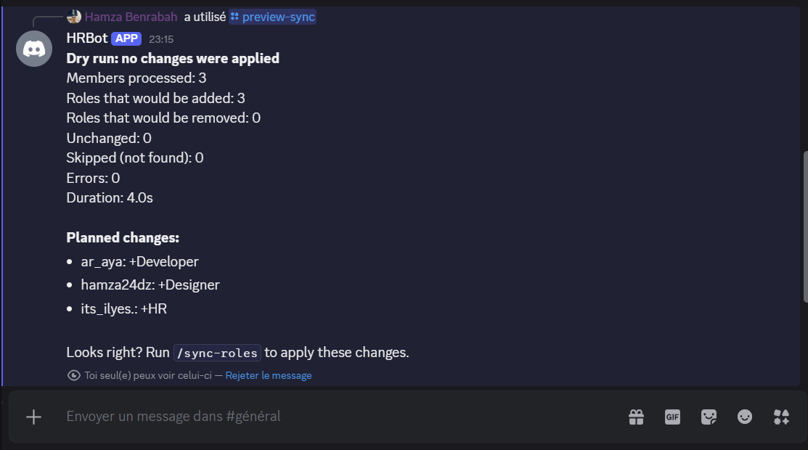
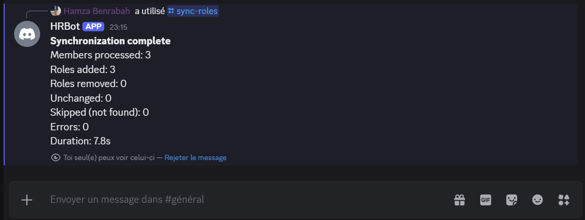
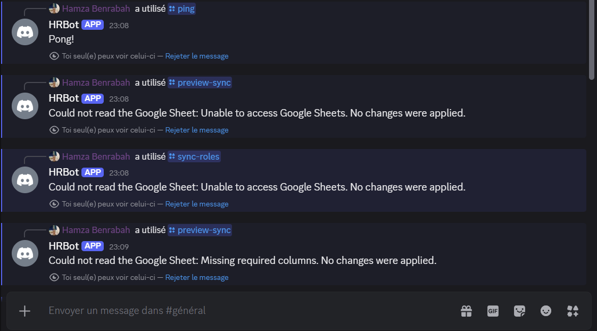

# Discord HR Role Management Bot

A Discord bot built for the **Shellmates Club**. It reads members' Discord usernames and roles from a **Google Sheet** and synchronizes the roles on the Discord server, replacing slow and error-prone manual role management on a server with 300+ members.

- Python + [discord.py](https://discordpy.readthedocs.io/) (slash commands)
- Google Sheets API through [gspread](https://docs.gspread.org/)
- Secrets stored in a `.env` file, never committed
- Automated tests with `pytest`

---

## Table of contents

1. [Features](#features)
2. [Project structure](#project-structure)
3. [Installation](#installation)
4. [Configuration](#configuration)
5. [Usage](#usage)
6. [Error handling](#error-handling)
7. [Security](#security)
8. [Tests](#tests)
9. [Troubleshooting](#troubleshooting)
10. [Demo](#demo)
11. [Team](#team)

---

## Features

**Core**

- **Reads a Google Sheet** of Discord usernames and roles.
- **Synchronizes roles** with `/sync-roles`: adds missing roles, removes managed roles that are no longer in the sheet, and updates them to match.
- **Managed roles only:** the bot only ever adds or removes the roles listed in `MANAGED_ROLES`. Any other role (`Admin`, `Moderator`, ...) is never touched.
- **Summary report** after each run: members processed, roles added, roles removed, and errors.
- **Access control:** only members with an authorized role (default `HR`) or Administrator permission can use the commands.
- **Error handling** for missing members, empty or duplicate usernames, roles that don't exist, permission problems and an unreachable sheet.

**Bonus features implemented**

- **Dry run:** `/sync-roles dry_run:True` shows what *would* change without applying anything.
- **`/preview-sync`:** shortcut for a dry run, listing who would get which roles.
- **Several roles per member** in one cell, separated by commas (`Designer, Content`).
- **Extended report:** duration, unchanged members and skipped members.
- **Long reports** are shortened in the message and attached in full as a `.txt` file.
- **Ephemeral replies:** results are visible only to the person who ran the command.
- **Rate limits and deferred replies:** a short pause between updates, and the reply is deferred because a sync of 300 members takes longer than Discord's 3-second limit.
- **Sync lock:** two synchronizations cannot run at the same time.

---

## Project structure

```
Discord-Bot_Shellmates-Integration-Program/
├── bot/
│   ├── main.py          # bot startup
│   ├── commands.py      # /ping, /sync-roles, /preview-sync
│   ├── sheets.py        # Google Sheets reading + validation
│   ├── sync.py          # computes the roles to add and remove
│   ├── discord_ops.py   # member matching, role operations, full synchronization
│   ├── report.py        # builds the summary message and the .txt report
│   ├── permissions.py   # authorization checks (HR / administrators)
│   └── config.py        # .env loading, managed roles list
├── tests/               # pytest test suite
├── .env.example         # template for your .env file
├── .gitignore
├── requirements.txt
└── README.md
```

The comparison logic lives in `sync.compute_changes(current, wanted, managed)`, a pure function that returns the roles to add and to remove. It is easy to test without a Discord server.

---

## Installation

### Prerequisites

- Python 3.10 or newer
- A Discord account and a server to test on
- A Google account
- Git

### 1. Clone the repository and install dependencies

```bash
git clone https://github.com/aya-amm/Discord-Bot_Shellmates-Integration-Program.git
cd Discord-Bot_Shellmates-Integration-Program
```

Create and activate a virtual environment:

```powershell
# Windows (PowerShell)
python -m venv .venv
.venv\Scripts\Activate.ps1
```

```bash
# Linux / macOS
python -m venv .venv
source .venv/bin/activate
```

Install the requirements:

```bash
pip install -r requirements.txt
```

> If PowerShell blocks the activation script, run
> `Set-ExecutionPolicy -Scope CurrentUser -ExecutionPolicy RemoteSigned` once and try again.

### 2. Create the Discord bot

1. Go to the [Discord Developer Portal](https://discord.com/developers/applications) and click **New Application**.
2. Open the **Bot** tab.
3. Under **Privileged Gateway Intents**, enable **Server Members Intent** and save.
   > **Important:** the bot needs this intent to see the full member list. The code sets `intents.members = True`, but without enabling it in the portal the username lookup fails and every member is reported as "not found".
4. Click **Reset Token** and copy the token. It is shown only once. You will put it in `.env`.
5. Open **OAuth2 → URL Generator**, tick the scopes `bot` and `applications.commands`, and under Bot Permissions tick **Manage Roles**.
6. Open the generated URL and invite the bot to your server.
7. In **Server Settings → Roles**, drag the bot's role **above** all the managed roles (for example `Developer`, `Designer`, `HR`). Discord does not let a bot manage roles that are higher than or equal to its own.

To get your server ID, enable **Developer Mode** (Discord Settings → Advanced), right-click the server icon and choose **Copy Server ID**.

### 3. Set up Google Sheets access

1. Open the [Google Cloud Console](https://console.cloud.google.com), create a project and enable the **Google Sheets API** (APIs & Services → Library).
2. Go to **IAM & Admin → Service Accounts**, create a service account, then **Keys → Add key → Create new key → JSON**.
3. Save the downloaded file as `credentials.json` in the project root. It is listed in `.gitignore`, so it is never committed.
4. Create the Google Sheet (see [Sheet format](#sheet-format)) and **share it with the service account's email** (the `client_email` in `credentials.json`). The **Viewer** role is enough, because the bot only reads.
5. Copy the sheet ID from its URL, the part between `/d/` and `/edit`:
   `https://docs.google.com/spreadsheets/d/`**`THIS_PART`**`/edit`

### 4. Create your `.env` file

```bash
cp .env.example .env        # Windows: Copy-Item .env.example .env
```

Fill in the values (see [Configuration](#configuration)).

### 5. Run the bot

```bash
python -m bot.main
```

Run it from the project root, with the virtual environment active. When it starts, the log shows `Logged in as <bot name>`. Type `/ping` in your server to check that it responds.

---

## Configuration

All settings live in the `.env` file.

| Variable | Required | Description |
|---|---|---|
| `DISCORD_TOKEN` | yes | Bot token from the Developer Portal (Bot tab). |
| `GUILD_ID` | yes | ID of the Discord server where the commands are registered. |
| `SHEET_ID` | yes | ID of the Google Sheet (from its URL). |
| `GOOGLE_CREDENTIALS_FILE` | no | Path to the service account JSON. Default: `credentials.json`. |
| `MANAGED_ROLES` | no | Comma-separated roles the bot may add or remove. Default: `Developer,Designer,HR`. |
| `AUTHORIZED_ROLES` | no | Comma-separated roles allowed to use the commands. Default: `HR`. Administrators are always allowed. |

Example:

```env
DISCORD_TOKEN=your-bot-token-here
GUILD_ID=123456789012345678
SHEET_ID=your-google-sheet-id
GOOGLE_CREDENTIALS_FILE=credentials.json
MANAGED_ROLES=Developer,Designer,HR
AUTHORIZED_ROLES=HR
```

If a required setting is missing, the bot stops at startup with a message naming it. After editing `.env`, restart the bot.

---

## Usage

### Sheet format

The sheet must have a tab named **`Members`** with these column headers in the first row: `DISCORD USERNAME` and `ROLE`.

| DISCORD USERNAME | ROLE |
|---|---|
| member1 | Developer |
| member2 | Designer |
| @Member3 | HR |
| member4 | Designer, Content |

Rules:

- Use the member's **unique account username** (for example `member1`), **not** the display name or the server nickname, which are not unique.
- Matching ignores letter case, extra spaces and a leading `@`.
- A member can have several roles in one cell, separated by commas.
- Roles are matched to Discord roles ignoring letter case.
- A role that is in the sheet but not in `MANAGED_ROLES` is ignored and shown as a warning in the report.

**Known limitation:** a user can change their username. If the sheet is not updated, that member is reported as "not found" and skipped.

### Commands

| Command | Description |
|---|---|
| `/sync-roles` | Synchronizes Discord roles with the Google Sheet. |
| `/sync-roles dry_run:True` | Shows what would change, without applying anything. |
| `/preview-sync` | Shortcut for a dry run, so HR can check the planned changes before applying them. |
| `/ping` | Checks that the bot is alive. |

All replies are ephemeral (only visible to you) because they contain member details. The commands only work inside the server and only for authorized members.

### Recommended workflow

1. Update the Google Sheet.
2. Run `/preview-sync` and check the planned changes.
3. Run `/sync-roles` to apply them.

### What the report shows

```
Synchronization complete
Members processed: 3
Roles added: 3
Roles removed: 2
Unchanged: 0
Skipped (not found): 0
Errors: 0
Duration: 3.4s
```

A dry run is labelled **"Dry run: no changes were applied"** and lists who would get which roles (`member1: +Developer -Designer`). Errors and warnings are listed below the numbers. When the report is too long for one Discord message, it is shortened and the full details are attached as `sync-report.txt`.

---

## Error handling

| Case | Behavior |
|---|---|
| Empty or duplicate username in the sheet | The row is skipped and reported. |
| Username not found in the server | Skipped, counted under "Skipped (not found)" and reported. |
| Role in the sheet does not exist on Discord | That role is skipped and reported. The member's other roles are still applied. |
| Role in the sheet is not a managed role | Ignored and shown as a warning. |
| Managed role does not exist on the server | Reported as an error. |
| Bot's role is lower than the target role | A permission error is reported and no change is made for that role. |
| Bot lacks the **Manage Roles** permission | The run stops and reports it, with no changes. |
| Discord API error on one member | Reported, and the sync continues with the next member. |
| Google Sheet unreachable, bad credentials, or missing columns | A clear message is shown and **no changes are applied**. |
| User without permission runs a command | Polite refusal message. |
| A sync is already running | The new request is refused until the first one finishes. |

---

## Security

- The Discord token and the Google credentials are loaded from `.env` and `credentials.json`. Both are listed in `.gitignore` and must **never** be committed.
- If a token or credentials file is ever exposed, reset the token in the Developer Portal and create a new service account key.
- Only members with an authorized role or Administrator permission can run commands.
- The bot only needs the **Manage Roles** permission and read-only access to the sheet.
- It never adds or removes roles outside `MANAGED_ROLES`.

---

## Tests

```bash
python -m pytest -v
```

The tests run without a Discord server or Google account (they use fakes). They cover:

- **Role computation:** adding a role, removing a managed role, leaving non-managed roles untouched.
- **Username and role matching:** ignoring case, spaces and `@`.
- **Sheet validation:** empty and duplicate usernames, missing columns, unreachable sheet.
- **Discord operations:** members and roles not found, roles above the bot, permission and API errors, dry run.
- **Permissions:** HR role, administrators, refusal of other members.
- **Report and commands:** summary numbers, long-report truncation with attachment, the sync lock, `/preview-sync`.

---

## Troubleshooting

| Problem | Likely cause and fix |
|---|---|
| `LoginFailure: Improper token has been passed` | The token in `.env` is wrong or was reset. Copy the current token from the Bot tab, with no quotes or spaces. |
| Slash commands do not appear | Check `GUILD_ID`, make sure the bot was invited with the `applications.commands` scope, and refresh Discord with Ctrl+R. |
| Every member is "not found" | The Server Members Intent is not enabled in the Developer Portal, or the sheet contains display names instead of usernames. |
| "Could not read the Google Sheet: Unable to access Google Sheets" | The sheet is not shared with the service account, `SHEET_ID` is wrong, `credentials.json` is missing, or the tab is not named `Members`. The bot's console log shows the technical reason. |
| "Missing required columns" | Row 1 of the `Members` tab must contain the headers `DISCORD USERNAME` and `ROLE`. |
| Permission errors for roles | Move the bot's role above the managed roles in Server Settings → Roles. |
| The bot cannot change the server owner's roles | This is a Discord restriction. Test with another member. |
| `No module named ...` | The virtual environment is not active. Activate it and run `pip install -r requirements.txt`. |

---

## Demo

<!-- Add your screenshots to docs/screenshots/ and keep these lines. -->

**Preview before applying**



**Synchronization result**



**Error handling**



---

## Team

Built by the Shellmates Club members:

- Benrabah Hamza
- Amir Aya Bouchra
- Dahane Ilyes
- 
